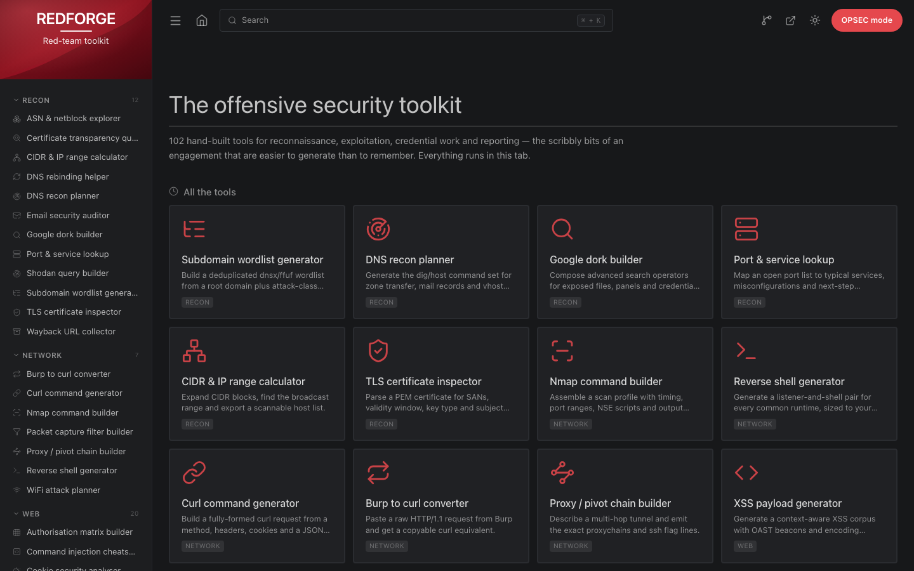
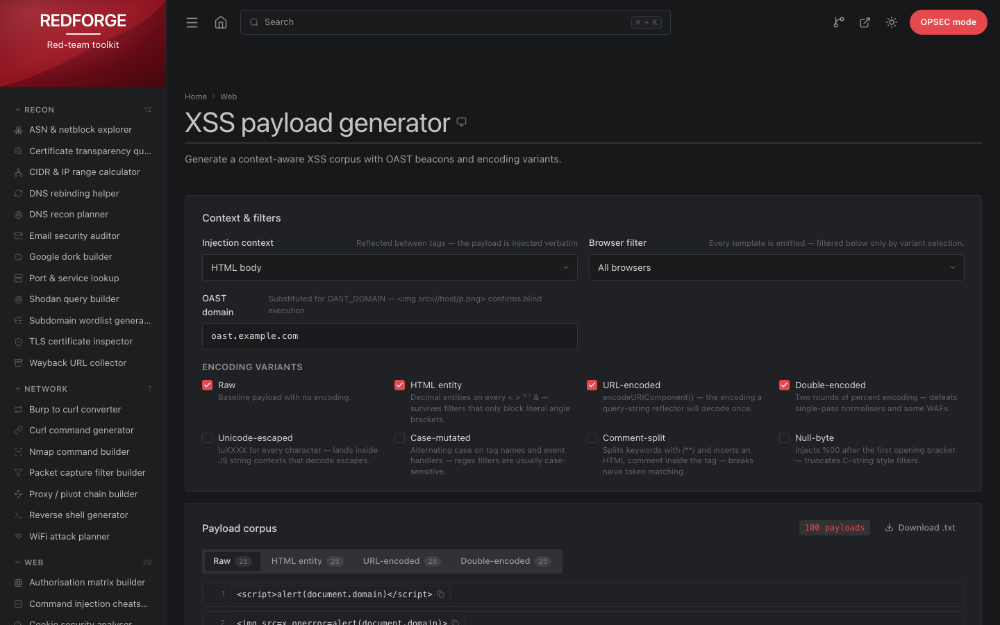
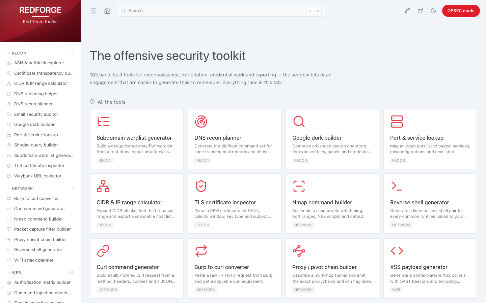

# RedForge

**it-tools, reimagined for red teams.** 102 browser-side tools for reconnaissance,
exploitation, credential work and reporting — the scribbly bits of an engagement
that are easier to generate than to remember.

Every tool runs entirely in the tab. No backend, no telemetry, no network calls:
paste a request, a certificate, a hash or a wordlist and the answer appears locally.



<table>
<tr>
<td width="50%"></td>
<td width="50%"></td>
</tr>
</table>

## Why another toolkit

it-tools solved the "I need a UUID, a base64 decode and a JWT parser right now"
problem for developers. A red team needs the same ergonomics for a different set of
chores: an nmap line with the right NSE scripts, a Kerberoasting command that names
the hashcat mode, an authz matrix that proves BOLA, a CVSS vector you can defend in
the report. Those are the tools here.

The interface is deliberately familiar — the same 240px hero sidebar, collapsible
categories, ⌘K palette, card grid and centred tool column — because muscle memory
is the whole point of a toolkit. The content is rebuilt from scratch around offensive
work, and every tool computes rather than narrates: the RSA planner really runs
Wiener's attack over continued-fraction convergents, the TOTP generator really signs
with WebCrypto, the SPF auditor really counts RFC 7208 lookups.

## What you get

- **102 tools** across 11 categories, each on its own route and its own JS chunk.
- **⌘K / Ctrl-K command palette** with fuzzy ranking over names, keywords and descriptions.
- **Favourites** and a collapsible category tree, both persisted in `localStorage`.
- **Dark and light themes** with no flash on load.
- **Deep links** — `/kerberos-attack-planner` is a real URL you can paste into a ticket.
- **Mobile layout** — the sidebar becomes a drawer below 700px.
- **Zero runtime services** — a 49 MB container that is just nginx and static files.

## Quick start

### Docker (recommended)

```bash
git clone https://github.com/YOUR-USERNAME/redforge.git
cd redforge
docker compose up -d --build
# → http://localhost:8080
```

`docker compose down` stops it. The container runs as uid 101 with a read-only root
filesystem, all capabilities dropped, a 128 MB / 1 CPU cap and a `/healthz` healthcheck.

Without Compose:

```bash
docker build -t redforge:latest .
docker run -d --name redforge -p 8080:8080 --read-only \
  --tmpfs /var/cache/nginx --tmpfs /var/run redforge:latest
```

Change the port with `REDFORGE_PORT=9090 docker compose up -d`. Replace
`YOUR-USERNAME` in the clone URLs with the account you push to.

### From source

Requires Node 22 or newer.

```bash
git clone https://github.com/YOUR-USERNAME/redforge.git
cd redforge
npm ci
npm run dev        # http://127.0.0.1:5178
```

Production build:

```bash
npm run build      # typechecks, then writes dist/
npm run preview    # serve dist/ on :5178
```

`dist/` is plain static files — copy it to any web server. Because routing is
client-side, the host must fall back to `index.html` for unknown paths (the bundled
`nginx.conf` already does).

A hot-reloading container is available too:

```bash
docker compose --profile dev up
# → http://localhost:5178
```

## Tool catalogue

| Category | Tools | Focus |
| --- | --- | --- |
| [Recon](#recon-12) | 12 | Passive mapping, wordlists and target triage. |
| [Network](#network-7) | 7 | Scanning, pivoting and transport-layer tooling. |
| [Web](#web-20) | 20 | Injection payloads, header abuse and request crafting. |
| [Web tokens](#web-tokens-6) | 6 | JWT and SAML inspection, forging and signature recovery. |
| [Exploit](#exploit-11) | 11 | Payload scaffolding, privesc and AD tradecraft. |
| [Credentials](#credentials-8) | 8 | Hash identification, cracking plans and credential generation. |
| [Crypto](#crypto-10) | 10 | Digests, key derivation, XOR and classical ciphers. |
| [Encoding](#encoding-10) | 10 | Encode, escape and obfuscate payloads for transport. |
| [Social engineering](#social-engineering-7) | 7 | Pretext design, lure copy and phishing-assessment planning. |
| [OSINT](#osint-3) | 3 | Entity pivots, breach and identity correlation planning. |
| [Reporting](#reporting-8) | 8 | Scoring, findings, evidence and rules-of-engagement. |
| **Total** | **102** | |

### Recon (12)

_Passive mapping, wordlists and target triage._

| Tool | Route | What it does |
| --- | --- | --- |
| **Subdomain wordlist generator** | `/subdomain-wordlist-generator` | Build a deduplicated dnsx/ffuf wordlist from a root domain plus attack-class prefixes. |
| **DNS recon planner** | `/dns-recon-planner` | Generate the dig/host command set for zone transfer, mail records and vhost discovery. |
| **Google dork builder** | `/google-dork-builder` | Compose advanced search operators for exposed files, panels and credential leaks. |
| **Port & service lookup** | `/port-service-lookup` | Map an open port list to typical services, misconfigurations and next-step checks. |
| **CIDR & IP range calculator** | `/cidr-ip-calculator` | Expand CIDR blocks, find the broadcast range and export a scannable host list. |
| **TLS certificate inspector** | `/certificate-inspector` | Parse a PEM certificate for SANs, validity window, key type and subject details. |
| **DNS rebinding helper** | `/dns-rebinding-helper` | Plan a rebinding payload: zone stanza, browser harness and TTL timing model. |
| **ASN & netblock explorer** | `/asn-netblock-explorer` | Parse ASN/prefix data, split it into /24 chunks and emit scannable target lists. |
| **Wayback URL collector** | `/wayback-url-collector` | Build CDX API queries for archived URLs, then filter them for parameters and backups. |
| **Email security auditor** | `/email-security-auditor` | Score SPF, DKIM and DMARC answers and decide whether the domain can be spoofed. |
| **Shodan query builder** | `/shodan-query-builder` | Compose Shodan, Censys and FOFA queries from facets, product filters and netblocks. |
| **Certificate transparency query** | `/certificate-transparency-query` | Build crt.sh queries and reduce certificate output to unique hostnames. |

### Network (7)

_Scanning, pivoting and transport-layer tooling._

| Tool | Route | What it does |
| --- | --- | --- |
| **Nmap command builder** | `/nmap-command-builder` | Assemble a scan profile with timing, port ranges, NSE scripts and output flags. |
| **Reverse shell generator** | `/reverse-shell-generator` | Generate a listener-and-shell pair for every common runtime, sized to your callback host. |
| **Curl command generator** | `/curl-generator` | Build a fully-formed curl request from a method, headers, cookies and a JSON body. |
| **Burp to curl converter** | `/burp-to-curl` | Paste a raw HTTP/1.1 request from Burp and get a copyable curl equivalent. |
| **Proxy / pivot chain builder** | `/pivot-chain-builder` | Describe a multi-hop tunnel and emit the exact proxychains and ssh flag lines. |
| **WiFi attack planner** | `/wifi-attack-planner` | Plan a WPA capture and crack run with aircrack-ng, hcxdumptool and hashcat. |
| **Packet capture filter builder** | `/packet-capture-filter-builder` | Build and validate tcpdump BPF and tshark display filters for an engagement. |

### Web (20)

_Injection payloads, header abuse and request crafting._

| Tool | Route | What it does |
| --- | --- | --- |
| **XSS payload generator** | `/xss-payload-generator` | Generate a context-aware XSS corpus with OAST beacons and encoding variants. |
| **SQL injection payload builder** | `/sql-injection-payload-builder` | Assemble union, boolean, time-based and stacked payloads for a parameter and DBMS. |
| **SSRF payload builder** | `/ssrf-payload-builder` | Build SSRF probes against cloud metadata, internal services and gopher targets. |
| **LFI / path traversal generator** | `/lfi-path-generator` | Generate traversal depth variants, filter chains and log-poisoning payloads. |
| **WAF bypass encoder** | `/waf-bypass-encoder` | Apply case, entity, double-encoding and comment transforms to a blocked payload. |
| **Command injection cheatsheet** | `/command-injection-cheatsheet` | Separator, blind and OAST variants for OS command injection, per platform. |
| **XPath / NoSQL / LDAP injection** | `/nosql-injection-builder` | Payload families for NoSQL, XPath and LDAP filter injection points. |
| **CSP analyser** | `/csp-analyser` | Check a Content-Security-Policy for bypassable directives, wildcards and missing protections. |
| **Open redirect generator** | `/open-redirect-generator` | Build redirect-bypass variants for allow-list filters and URL parsers. |
| **Security header auditor** | `/security-header-auditor` | Score a response header set and surface the missing hardening directives. |
| **HTML Smuggling / download payload builder** | `/html-smuggling-builder` | Produce a self-contained HTML page that assembles an attachment client-side. |
| **Parameter fuzz list** | `/parameter-fuzz-list` | Generate parameter-name wordlists for hidden-parameter and mass-assignment discovery. |
| **XS-Leak generator** | `/xs-leak-generator` | Cross-site leak payloads: frame counting, onload oracles and timing probes. |
| **CSRF PoC builder** | `/csrf-poc-builder` | Emit an auto-submitting cross-site request forgery PoC and test it against each defence. |
| **SSTI payload builder** | `/ssti-payload-builder` | Template-injection detection ladder for Jinja2, Twig, Freemarker and six more engines. |
| **GraphQL attack builder** | `/graphql-attack-builder` | Introspection, suggestion enumeration, alias overloading and depth-cost queries. |
| **Authorisation matrix builder** | `/authz-matrix-builder` | Build a role-by-endpoint access-control matrix and the request set that tests it. |
| **File upload bypass plan** | `/file-upload-bypass-plan` | Plan extension, MIME, magic-byte and parser-confusion variants for an upload form. |
| **Cookie security analyser** | `/cookie-security-analyser` | Parse Set-Cookie headers and judge flags, prefixes, scope and SameSite behaviour. |
| **HTTP smuggling analyser** | `/http-smuggling-analyser` | Detect Content-Length and Transfer-Encoding conflicts in a raw request and pick a probe. |

### Web tokens (6)

_JWT and SAML inspection, forging and signature recovery._

| Tool | Route | What it does |
| --- | --- | --- |
| **JWT decoder** | `/jwt-decoder` | Decode header, payload and signature; flag risky claims and mismatched algorithms. |
| **JWT forger** | `/jwt-forger` | Sign a test token with HS256, none, or an attacker-supplied RSA key. |
| **Basic auth & header builder** | `/basic-auth-header` | Encode a username and password into Basic, Bearer or Digest-style headers. |
| **SAML assertion decoder** | `/saml-decoder` | Decode a SAMLResponse, extract claims and spot unsigned attribute trust. |
| **OAuth flow builder** | `/oauth-flow-builder` | Assemble an OAuth2/OIDC flow and the redirect_uri bypass variants worth trying. |
| **API key pattern detector** | `/api-key-pattern-detector` | Scan text for AWS, GCP, Stripe, Slack and GitHub key formats with entropy scoring. |

### Exploit (11)

_Payload scaffolding, privesc and AD tradecraft._

| Tool | Route | What it does |
| --- | --- | --- |
| **XXE payload generator** | `/xxe-payload-generator` | Generate in-band, OAST and file-read XML entities for XML parser testing. |
| **Deserialization payload builder** | `/deserialization-payload-builder` | Build gadget chains and marker payloads for Java, PHP, Python and .NET. |
| **MSFvenom command builder** | `/msfvenom-builder` | Compose a msfvenom line for a chosen payload, LHOST, LPORT and output format. |
| **Linux privesc checklist** | `/linux-privesc-checklist` | Prioritised enumeration checklist with the commands that find each bug. |
| **Active Directory attack plan** | `/ad-attack-plan` | Map a domain posture to the next credential, delegation or ACL step. |
| **Nuclei template generator** | `/nuclei-template-generator` | Draft a YAML template from a request, matcher type and severity. |
| **Wordlist mutator (hashcat rules)** | `/wordlist-mutator` | Apply or generate hashcat rule chains and preview the resulting mutations. |
| **CVE PoC scaffolder** | `/cve-poc-scaffolder` | Scaffold a reproducible proof of concept with assertions, evidence list and disclosure note. |
| **Linux capability explorer** | `/linux-capability-explorer` | Match SUID binaries and file capabilities against known escalation paths. |
| **Windows privesc checklist** | `/windows-privesc-checklist` | Work through Windows escalation checks with the command and the tell for each. |
| **C2 profile builder** | `/c2-profile-builder` | Compose a malleable C2 profile with URIs, headers, jitter and staging blocks. |

### Credentials (8)

_Hash identification, cracking plans and credential generation._

| Tool | Route | What it does |
| --- | --- | --- |
| **Hash generator** | `/hash-generator` | Compute MD5, SHA-1/2/3, NT, CRC32 and BLAKE digests plus base64 encodings. |
| **Hash identifier** | `/hash-identifier` | Match a hash to its likely algorithm and get the matching hashcat mode. |
| **Password profiler** | `/password-profiler` | Score a password strength and estimate offline crack time across attack models. |
| **Credential generator** | `/credential-generator` | Generate policy-compliant test accounts or seeded password candidates. |
| **Offline crack planner** | `/crack-planner` | Estimate crack time per GPU hash rate and choose the attack strategy. |
| **Password spray planner** | `/password-spray-planner` | Size a spray against a lockout policy and emit the exact tool commands and schedule. |
| **Kerberos attack planner** | `/kerberos-attack-planner` | Plan AS-REP roasting, Kerberoasting and delegation abuse with the commands. |
| **NTLM relay planner** | `/ntlm-relay-planner` | Plan a relay path: coercion primitive, listener flags, targets and signing checks. |

### Crypto (10)

_Digests, key derivation, XOR and classical ciphers._

| Tool | Route | What it does |
| --- | --- | --- |
| **HMAC generator** | `/hmac-generator` | Compute an HMAC over a message with SHA-1/256/384/512 in hex or base64. |
| **PBKDF2 generator** | `/pbkdf2-generator` | Derive a hex key from a password, salt, iteration count and length. |
| **AES encrypt / decrypt** | `/aes-encrypt-decrypt` | GCM and OpenSSL-compatible CBC round-trips for payload and config handling. |
| **XOR cracker** | `/xor-cracker` | Single-byte and repeating-key XOR with scoring, key recovery and hex output. |
| **Classical cipher workbench** | `/classical-ciphers` | ROT, Atbash, Vigenère, Beaufort and rail-fence encode and decode. |
| **Entropy & randomness analyser** | `/entropy-analyser` | Shannon entropy, character-class spread and repetition scoring for secrets. |
| **Hash length extension planner** | `/hash-length-extension-planner` | Compute glue padding and the forged digest state for MD5/SHA-1 length extension. |
| **TLS cipher suite parser** | `/tls-cipher-suite-parser` | Decode IANA and OpenSSL cipher names into key exchange, strength and weakness verdicts. |
| **RSA attack planner** | `/rsa-attack-planner` | Test RSA parameters for small-e, common-modulus, Wiener and shared-prime weaknesses. |
| **TOTP generator** | `/totp-generator` | Generate HOTP and TOTP codes from a base32 secret and test the surrounding windows. |

### Encoding (10)

_Encode, escape and obfuscate payloads for transport._

| Tool | Route | What it does |
| --- | --- | --- |
| **Base64 encoder / decoder** | `/base64-encoder` | Text, URL-safe and base32 variants with strict validation on decode. |
| **URL encoder / decoder** | `/url-encoder` | Percent-encoding, double-encoding and Unicode escapes for request smuggling tests. |
| **Hex & binary converter** | `/hex-binary-converter` | Convert hex, binary, decimal and ASCII with hexdump preview. |
| **PowerShell obfuscator** | `/powershell-obfuscator` | Produce a base64 UTF-16LE -EncodedCommand form of any PowerShell one-liner. |
| **Unicode homoglyph obfuscator** | `/homoglyph-obfuscator` | Swap characters for lookalikes to test filters and IDN handling. |
| **Text repertoire (NATO + leetspeak)** | `/text-repertoire` | NATO phonetic spelling, leetspeak and case mutation for spoken and visual pretexts. |
| **Unicode normalisation lab** | `/unicode-normalisation-lab` | Compare NFC/NFD/NFKC/NFKD forms and see which characters survive sanitisation. |
| **Quoted-printable codec** | `/quoted-printable-codec` | Encode and decode MIME quoted-printable with soft line breaks and strict error reporting. |
| **Base58 / Base85 codec** | `/base58-base85-codec` | Encode and decode Base58, Base85 and Base91 with the common alphabet variants. |
| **String escaping lab** | `/string-escaping-lab` | Escape and unescape strings for C, JSON, SQL, XML, shell and regex contexts. |

### Social engineering (7)

_Pretext design, lure copy and phishing-assessment planning._

| Tool | Route | What it does |
| --- | --- | --- |
| **Phishing email composer** | `/phishing-email-generator` | Draft lure copy, headers and a pretext skeleton for an authorised assessment. |
| **Pretext builder** | `/pretext-builder` | Adapt a pretext to a target persona, channel and authority lever. |
| **Canary token generator** | `/canary-token-generator` | Create a detectable token or fake credential with a monitoring plan. |
| **Pretext working-hours calculator** | `/timezone-window` | Find the overlapping business hours for a target location and your operator team. |
| **Vishing script builder** | `/vishing-script-builder` | Build a call script with escalation steps, objection handling and abort lines. |
| **Smishing template builder** | `/smishing-template-builder` | Draft SMS lure variants with segment counts, merge fields and short-link slots. |
| **USB drop brief** | `/usb-drop-brief` | Plan a USB drop assessment: bait, payload shape, persistence and beacon expectations. |

### OSINT (3)

_Entity pivots, breach and identity correlation planning._

| Tool | Route | What it does |
| --- | --- | --- |
| **OSINT entity pivot planner** | `/osint-entity-pivot-planner` | Turn one seed entity into a staged lookup, enrichment and correlation plan. |
| **Social graph mapper** | `/social-graph-mapper` | Map entities and relationships into a graph and export DOT or Mermaid. |
| **Username enumeration planner** | `/username-enumeration-planner` | Plan a username sweep across sites with the check URL and what a hit looks like. |

### Reporting (8)

_Scoring, findings, evidence and rules-of-engagement._

| Tool | Route | What it does |
| --- | --- | --- |
| **CVSS 3.1 calculator** | `/cvss-calculator` | Score a finding from the base metrics and get the vector string plus rating. |
| **Finding writer** | `/finding-writer` | Fill a structured finding template and export clean Markdown. |
| **Rules of engagement builder** | `/rules-of-engagement` | Assemble a scope, timeline, contact and limitations block for the assessment. |
| **Evidence timeline** | `/evidence-timeline` | Timestamp and normalise log evidence into a consistent UTC sequence. |
| **Engagement notes** | `/engagement-notes` | Keep a persistent operator log in this browser and export it as Markdown. |
| **Attack narrative timeline** | `/attack-narrative-timeline` | Order engagement actions into a MITRE-mapped narrative with evidence refs and exports. |
| **Remediation tracker** | `/remediation-tracker` | Track findings to remediation with owners, SLA clocks and CSV export. |
| **Executive summary generator** | `/executive-summary-generator` | Turn engagement facts into an executive summary plus a short risk narrative. |

## Keyboard shortcuts

| Key | Action |
| --- | --- |
| `⌘K` / `Ctrl-K` | Open the command palette |
| `/` | Focus the palette |
| `↑` `↓` | Move through results |
| `Enter` | Open the highlighted tool |
| `Esc` | Close the palette or the mobile drawer |

## Architecture

```
src/
├── main.tsx                 React 19 entry
├── App.tsx                  router: /, /about, /:toolPath
├── index.css                Tailwind 4 tokens, light + dark
├── components/
│   ├── Layout.tsx           240px sidebar, navbar, drawer, command palette
│   ├── ToolLayout.tsx       centred 1200px column: breadcrumb, h1, description
│   ├── HeroGradient.tsx     the red gradient hero block
│   ├── Modal.tsx            native <dialog> wrapper
│   ├── ToolIcon.tsx         registry-path → lucide icon
│   ├── tool-icons.ts        the icon map
│   └── ui.tsx               Card, Button, Input, Select, Tabs, KVTable, …
├── lib/
│   ├── crypto.ts            MD4, MD5, SHA-1/256/384/512, NTLM, HMAC, PBKDF2, AES-GCM, OpenSSL Salted__
│   ├── domain.ts            IPv4/CIDR/URL parsing, private-range checks
│   ├── bytes.ts             UTF-8, base64, base32, hexdump, Shannon entropy
│   ├── encoding.ts          percent, ROT13, Caesar, Atbash, PEM helpers
│   ├── rng.ts               seeded PRNG for reproducible wordlists
│   ├── redteam-data.ts      payload, port, prefix and template datasets
│   └── hooks.ts             useLocalStorage, useCopy, useHotkey, useMediaQuery
├── tools/
│   ├── registry.ts          one entry per tool; every component is lazy()
│   └── <category>/<Name>.tsx
└── pages/                   HomePage, AboutPage
```

Adding a route is a single registry entry — `{ path, name, description, category,
keywords, component: lazy(() => import('./recon/Thing')) }` — and the sidebar, palette,
card grid and route all pick it up. [`CONTRACT.md`](CONTRACT.md) documents the
component contract the tools follow.

## Verification

```bash
npm run typecheck        # tsc --noEmit
npm run build            # typecheck + production bundle
npm run smoke            # headless pass over every route (needs the dev server)
```

Current state: typecheck clean, 102 lazy chunks, entry bundle 350 kB
(112 kB gzipped), and `node scripts/smoke.mjs` reports
`OK — 104 routes clean` after typing into every tool and clicking
its buttons. The container has been checked the same way at `:8080`: deep links
return 200, `/assets/*` is served immutable and gzipped, and `/.env` is a 404.

## Privacy and data handling

There is no server to send anything to. Every computation happens in the browser;
the bundle makes no outbound requests. The only persistence is `localStorage`, under
the `redforge:` prefix — theme, favourites, collapsed categories and the tools that
keep a working state (checklists, trackers, notes). Clearing site data resets it.
Generated payloads intentionally contain placeholder hosts such as `example.com`,
`203.0.113.10` and `oast.example.com`; replace them with targets you are authorised
to test.

## Licence

MIT — see [LICENSE](LICENSE).
